# 롱잡고알바감 플레이 가이드

> 처음 하는 사람을 위한 안내서. 수치는 따로 적지 않으면 **보통맛** 기준이다.
> 게임 속 종목 · 코인 · 시세 · 돈은 모두 가상이다. 이 문서에 나오는 매매 이야기는 게임 규칙 설명일 뿐, 실제 투자와는 아무 상관이 없다.

---

## 1. 한 장 요약

- **목표**: 여자친구 미래의 빚 **3,000만 원**을 **28일** 안에 0원으로 만든다. 다 갚으면 엔딩.
- **하루 = 오전 · 오후 · 밤, 세 칸.** 칸마다 행동 하나(장 보기 · 미래랑 놀기 · 알바 · 쉬기 · 외출)를 고르면 그 칸이 끝난다. 고르는 동안 시계는 멈춰 있다.
- **돈 버는 길은 둘**: 알바(느리지만 안전) · 장 보기(시세를 보며 사고팖, 빠르지만 위험).
- **1~5일째는 평일, 6 · 7일째는 주말.** 주말엔 주식 시장이 쉬고 코인만 움직인다.
- **7일마다(7 · 14 · 21 · 28일째) 밤에 김사장이 온다.** 이번 주 이자 + 원금 일부를 내야 한다. 금액은 맨 위 띠의 "이번 주 납부"에 늘 떠 있다.
- **납부를 두 번 연속 못 하면** 만기 전에 원양어선으로 끝난다.
- **28일째 밤이 만기.** 빚이 남아 있으면 남은 빚과 미래 호감에 따라 엔딩이 갈린다.
- 미래 **호감**이 높아야(60 이상) 둘이 웃는 엔딩을 볼 수 있다. 돈만 갚는다고 끝이 아니다.

---

## 2. 화면 읽는 법

### 맨 위 상태 띠

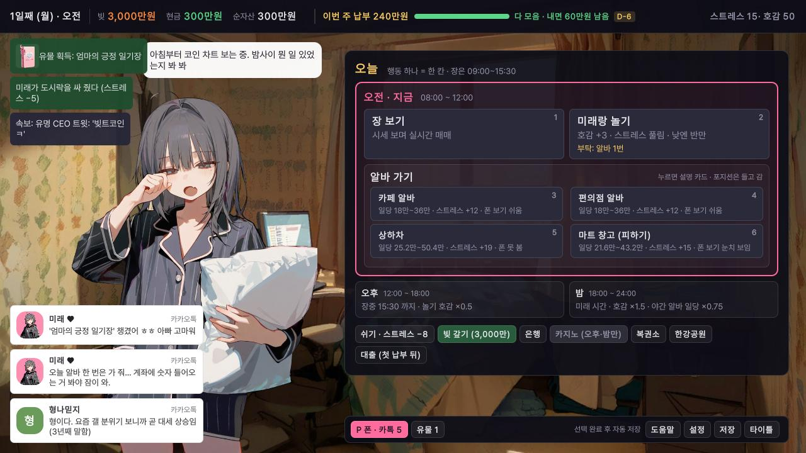

*맨 위 한 줄이 상태 띠, 오른쪽 큰 판이 "오늘" 계획판. 분홍 테두리가 지금 칸이다.*

| 띠의 칸 | 뜻 |
|---|---|
| 1일째 (월) · 오전 | 오늘 날짜와 지금 칸 |
| 빚 | 김사장에게 남은 빚 |
| 현금 | 지금 바로 쓸 수 있는 돈. 바뀌면 옆에 ± 숫자가 잠깐 뜬다 |
| 순자산 | 현금 + 들고 있는 주식 · 코인 평가액. **빚은 빼지 않은 값**이다 |
| 이번 주 납부 N만원 + 막대 | 이번 납부일에 낼 돈. 현금이 충분하면 "다 모음 · 내면 N 남음", 모자라면 "현금 A / 납부 B" |
| D-n | 납부일까지 남은 날. 납부일 당일은 D-DAY |
| 스트레스 · 호감 | 미래의 마음 상태 (7절) |

장 보기 중에는 띠가 바뀐다. 맨 앞이 시계와 속도(Ⅱ · 1x · 2x · 4x), 맨 끝이 "그만 보기"이고, 빚 · 스트레스 · 호감은 빠진다(상태 카드에서 볼 수 있다).

### 상태 카드

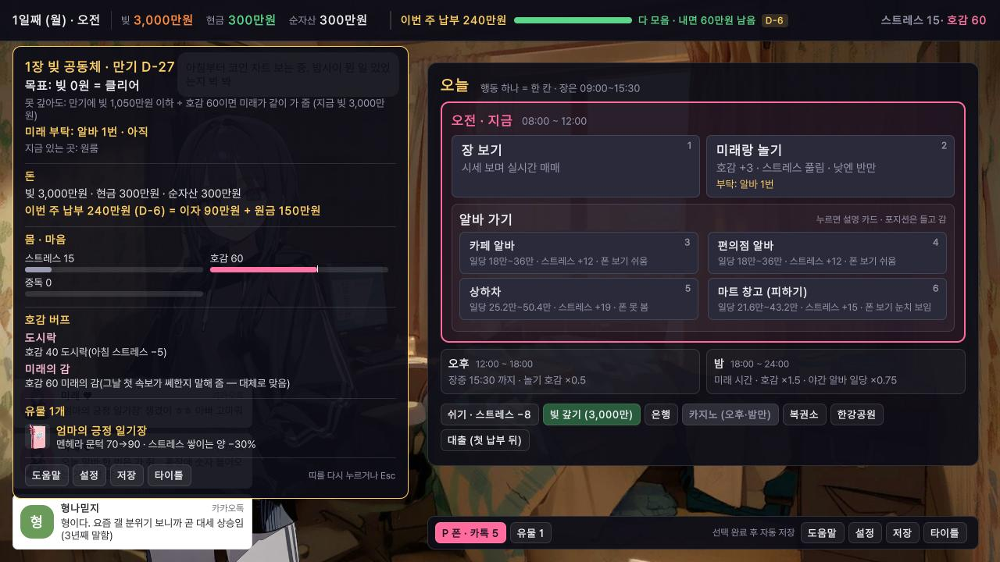

*띠를 누르면 열린다. 목표 · "못 갚아도" 조건 · 미래 부탁 · 이번 주 납부 내역(이자 + 원금) · 호감 버프 · 유물이 한 장에 있다.*

- **못 갚아도: 만기에 빚 1,050만원 이하 + 호감 60이면 미래가 같이 가 줌** 같은 줄이 보이는데, 빚을 다 못 갚았을 때의 목표다.
- 아래 단추로 도움말 · 설정 · 저장 · 타이틀에 갈 수 있다. 띠를 다시 누르거나 Esc 로 닫는다.

### 집 — "오늘" 계획판

- **지금 칸**(분홍 테두리): 할 수 있는 행동 카드가 있다. 장 보기 · 미래랑 놀기 · 알바 4종. 카드 오른쪽 위 숫자가 단축키다.
- **끝난 칸**: 그 칸에 한 일과 그 칸에서 벌거나 잃은 돈.
- **남은 칸**: 그 칸의 성격 한 줄. "오후 — 장중 15:30 까지 · 놀기 호감 ×0.5", "밤 — 미래 시간 · 호감 ×1.5 · 야간 알바 일당 ×0.75".
- **칩 줄**(판 아래쪽): 쉬기 · 빚 갚기 · 은행 · 카지노 · 복권소 · 한강공원 · 대출. 지금 칸에 닫힌 곳은 흐리게 "(오후·밤만)"처럼 열리는 칸이 적혀 있다.
- 둘째 날부터 칩 줄 아래에 **"어제: …"** 한 줄(칸마다 한 일 · 손익 · 합계)이 붙는다.
- 맨 아래 작은 줄: **P 폰**(안 읽은 카톡 수) · 유물 · 도움말 · 설정 · 저장 · 타이틀.

### 폰

P 키로 연다. **폰을 여는 것만으로는 칸이 지나가지 않는다.** 집에서는 증권(코인을 급히 볼 때) · 카톡 · 주갤 · 뉴스 · 정보 수첩이 있고, 장 보기 화면 위에서는 증권이 빠진다(매매는 데스크 주문 패널 한 곳에서).

---

## 3. 하루 한 칸에 할 수 있는 일

### 칸의 시간

| 칸 | 시각 | 성격 |
|---|---|---|
| 오전 | 09:00 ~ 12:00 | 하루는 주식 장이 여는 09:00 에 시작한다 |
| 오후 | 12:00 ~ 18:00 | 주식 장은 15:30 에 닫힌다 · 놀기 호감 ×0.5 |
| 밤 | 18:00 ~ 24:00 | 미래 시간 · 놀기 호감 ×1.5 · 야간 알바 일당 ×0.75 |

주말(6 · 7일째)은 주식 장이 열리지 않고, 낮 놀기 · 야간 알바의 깎임도 없다.

### 행동 목록

| 행동 | 하는 일 | 칸을 쓰나 |
|---|---|---|
| **장 보기** | 트레이딩 데스크에서 그 칸 동안 실시간 시세를 보며 사고판다 (4절) | 씀 |
| **미래랑 놀기** | 호감이 오르고 스트레스가 풀린다. 같은 날 두 번째부터는 호감이 조금만 오른다 | 씀 |
| **알바 가기** | 미니게임. 잘할수록 일당이 많다 | 씀 |
| **쉬기 / 자기** | 스트레스 −8. 밤에 "자기"를 고르면 푹 자서 다음 장날(금 · 토 · 일 밤이면 월요일) 무료 리포트 +1 | 씀 |
| 한강공원 | 산책(스트레스 −12) · 조깅(−10) · 한강 라면(−16, 8,000원). 같은 날 같은 걸 또 하면 효과가 줄어든다 | 씀 |
| 은행 | 이자 미리 내기 · 원금 상환 | 씀 |
| 카지노 (오후 · 밤만) | 홀짝 · 슬롯. 베팅 상한 없음, 한 번에 최대 3판. 길게 보면 잃는 쪽이다 | 씀 |
| 복권소 | 빚또(1만 원). 그날 밤에 추첨 | 씀 |
| **빚 갚기** (칩) | 현금을 바로 김사장에게 보낸다 | **안 씀** |
| 대출 (칩) | 김사장에게 빌린다 (6절) | 안 씀 |
| 폰 | 카톡 · 주갤 · 뉴스 · 코인 확인 | 안 씀 |

### 알바 4종

| 알바 | 일당 (한 칸) | 스트레스 | 폰 보기 |
|---|---|---|---|
| 카페 알바 | 18만 ~ 36만 | +12 | 쉬움 (들킬 확률 20%) |
| 편의점 알바 | 18만 ~ 36만 | +12 | 쉬움 (들킬 확률 20%) |
| 상하차 | 25.2만 ~ 50.4만 | +19 | 못 봄 |
| 마트 창고 (피하기) | 21.6만 ~ 43.2만 | +15 | 눈치 보임 (들킬 확률 35%) |

- 일당은 미니게임 성과에 따라 범위 안에서 정해진다. 평일 밤에는 ×0.75.
- 알바를 연달아 가면 스트레스가 조금씩 더 쌓인다.
- 계획판의 알바 카드를 누르면 바로 설명 카드가 뜨고, "일 시작"으로 들어간다. "다른 알바 고르기"는 시간을 쓰지 않는다.

**알바 중에도 시세는 흐른다.** 들고 있는 포지션은 알바 화면 오른쪽 아래 구석에 손익이 보이고, 거기서 **몰래 폰 보기**로 정리할 수 있다.

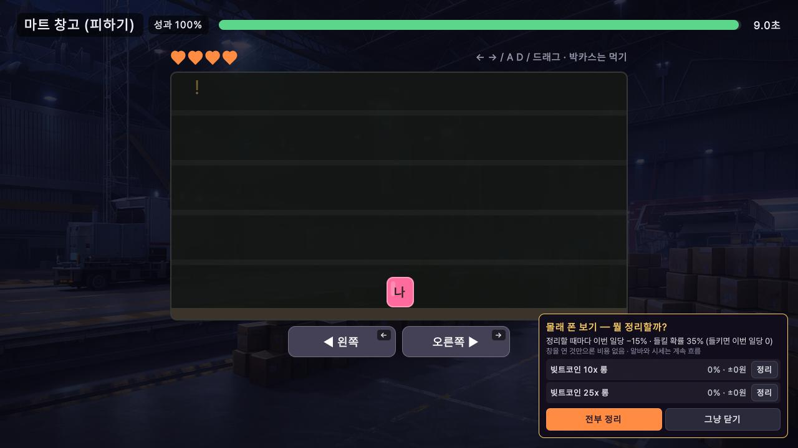

*오른쪽 아래 창: 코인은 [정리], 주식은 [팔기], 한 번에 [전부 정리]. 맨 위 줄에 깎이는 일당과 들킬 확률이 적혀 있다.*

- 정리할 때마다 그 알바 일당이 15%씩 깎인다. 창을 열어 보기만 하면 비용이 없다.
- 들키면 그 칸 일당이 0원이 되고 스트레스가 오른다.
- 상하차 중에는 폰을 꺼낼 수 없다(대신 일당이 가장 세다).
- 주식은 장이 열려 있고 하한가에 잠기지 않았을 때만 팔린다.

### 저녁 정산

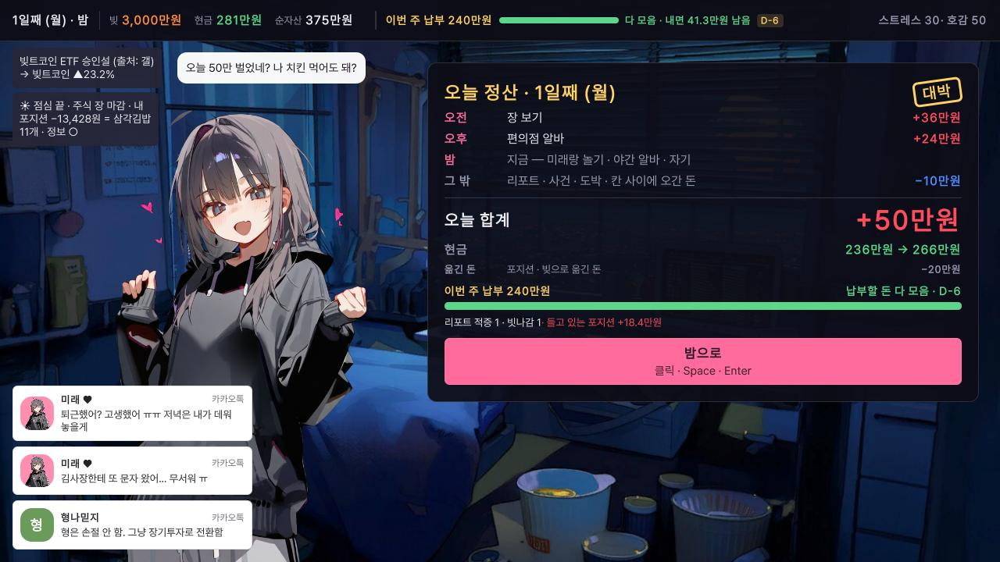

*밤 칸이 시작될 때 뜨는 한 장. 오전 · 오후 줄 + 그 밖 = 오늘 합계. 아래 막대는 이번 주 납부까지 모은 정도.*

"옮긴 돈"은 포지션에 넣거나 빚을 갚는 등 번 것도 쓴 것도 아닌 돈이다.

---

## 4. 장 보기 (트레이딩 데스크)

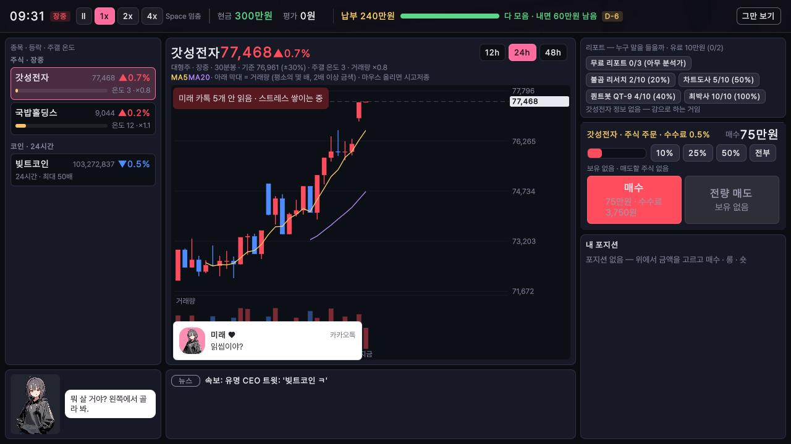

*왼쪽 종목 목록, 가운데 큰 차트, 오른쪽 위부터 리포트 → 주문 → 내 포지션, 아래는 소식 띠와 미래 작은 창.*

### 화면 구역

| 구역 | 보이는 것 |
|---|---|
| 맨 위 띠 | 시계 · 장중 표시 · 속도(Ⅱ 멈춤 · 1x · 2x · 4x) · 현금 · 평가 · 납부 · **그만 보기** |
| 왼쪽 종목 목록 | 이름 · 등락. 주식은 **주갤 온도 막대**와 **거래량 배수**(×0.8 처럼). 들고 있으면 "보유", 못 팔면 "하한가 잠김" 꼬리표 |
| 가운데 차트 | 봉(30분봉) + 아래 거래량 막대. 12h · 24h · 48h. 평단 · 청산가 · 하한가 선 |
| 오른쪽 위 리포트 | 분석가 칩(이름 + 전적) · 무료 리포트 단추 |
| 오른쪽 가운데 주문 | 금액 · 배율 · 예상 청산가 · 이번 칸 청산 확률 · 증거금 상한 남은 돈 · 결과 줄 · 버튼 |
| 오른쪽 아래 내 포지션 | 손익 큰 숫자 · 절반 팔기 · 전부 팔기 · 닫기 · 예약 |
| 아래 소식 띠 | 속보 · 후속 · 체결 · 설거지 · 발표 · 리포트 기한 (최근 몇 줄) |
| 왼쪽 아래 미래 창 | 리포트를 받았을 때 · 주문했을 때의 반응, 그 밖의 한마디 |

- 1x 에서 게임 속 1시간이 약 30초다. 숫자 키 1 · 2 · 4 로 속도, Space 로 멈춤/재개.
- 칸이 끝나는 시각이 되면 장 보기가 저절로 끝난다. 중간에 나오려면 "그만 보기"(포지션이 있으면 두 번 누르기).

### 주식과 코인

| | 주식 | 코인 |
|---|---|---|
| 거래 시간 | 평일 09:00 ~ 15:30, **장 보기 칸에서만** | 24시간, 집에서 폰으로도 |
| 방향 | 사기 · 팔기 | **롱**(오름에 걸기) · **숏**(내림에 걸기). 숏은 2주차부터 |
| 배율 | 없음 | 1 · 2 · 3 · 5 · 10 · 25 · 50배 (종목마다 최대가 다름) |
| 수수료 | 0.5% | 포지션 크기(증거금 × 배율)의 0.1%, 열 때와 닫을 때 |
| 그 밖 | 하루 기준가에서 ±30% 가 상한가/하한가 | 2배 이상은 칸이 끝날 때마다 펀딩비(증거금 × 배율 × 0.27%) |

- 처음 열려 있는 종목은 갓성전자 · 국밥홀딩스 · 빚트코인. **8 · 15 · 22일째에 새 종목이 상장**된다.
- 주말 동안의 주식 움직임은 쌓였다가 **월요일 오전에 한꺼번에** 반영된다. 금요일에 주식을 들고 주말을 넘길지 정해야 한다.

### 코인 주문 · 증거금 상한 · 청산

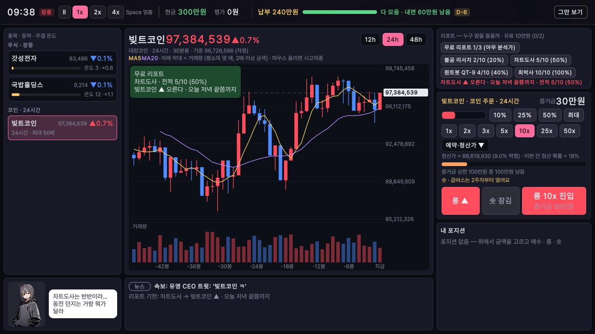

*배율 칩 아래에 청산가와 "이번 칸 청산 확률", 그 아래에 "증거금 상한 100만원 중 100만원 남음"이 보인다.*

- **증거금**: 코인 포지션에 넣은 내 돈. 최소 1만 원.
- **증거금 상한**: 코인 증거금 합계의 한도. 배율은 처음부터 자유지만 넣을 수 있는 금액이 묶인다.

  | 주차 | 1주 | 2주 | 3주 | 4주 |
  |---|---|---|---|---|
  | 증거금 상한 | 100만 | 300만 | 500만 | 800만 |

- **청산**: 가격이 반대로 가서 손실이 증거금의 90%에 닿으면 강제로 닫힌다. 돌려받는 건 증거금의 10~30% 정도. 칸 중간에 잠깐 튀는 꼬리로도 닿을 수 있다.
- 배율이 높을수록 청산가가 가깝다. 10배면 가격이 9% 반대로 가면 청산이다.

### 주문 넣기 · 두 번 누르기

1. 왼쪽 목록에서 종목을 고른다.
2. 금액을 고른다(10% · 25% · 50% · 전부/최대). 코인이면 배율과 롱/숏도.
3. 매수(또는 진입) 버튼. 결과는 버튼 바로 위 결과 줄에 뜬다.

위험한 조작은 **한 번 더 눌러야** 나간다. 첫 누름에 글자가 바뀌고, 4초 안에 다시 눌러야 한다.

| 두 번 누르는 경우 |
|---|
| 코인 진입: 25배 이상 · 증거금 100만 이상 · 이번 칸 청산 확률 30% 이상 중 하나 |
| 주식 전부 팔기 (늘) · 포지션 줄의 절반 팔기 (100만 이상일 때) · 코인 전부 정리 |
| 코인 닫기: 증거금 + 손익 100만 이상이거나 25배 이상 |
| 유료 리포트 · 복학 통장 채우기 · 포지션을 든 채 "그만 보기" |

### 예약 손절 · 익절

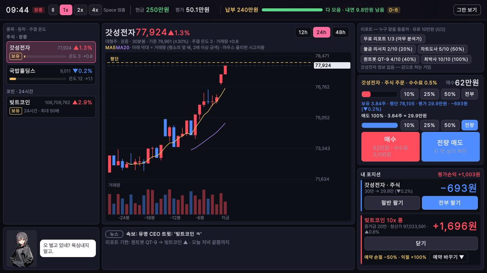

*코인 포지션 줄 아래 "예약 손절 −50% · 익절 +100%"와 [예약 바꾸기]. 손익은 증거금 대비 비율이다.*

- 손절: 없음 · −30% · −50% · −70%. 익절: 없음 · +50% · +100% · +200%.
- **장 보기 칸에서만 걸 수 있다.** 걸어 두면 알바 중이든 자는 중이든 그 선에 닿을 때 정리된다.
- 가격이 한 번에 청산선을 넘어 버리면 손절이 아니라 청산이 된다. 리포트 발표처럼 한 번에 튀는 움직임은 예약으로 못 피한다.

### 분석가 리포트 읽기

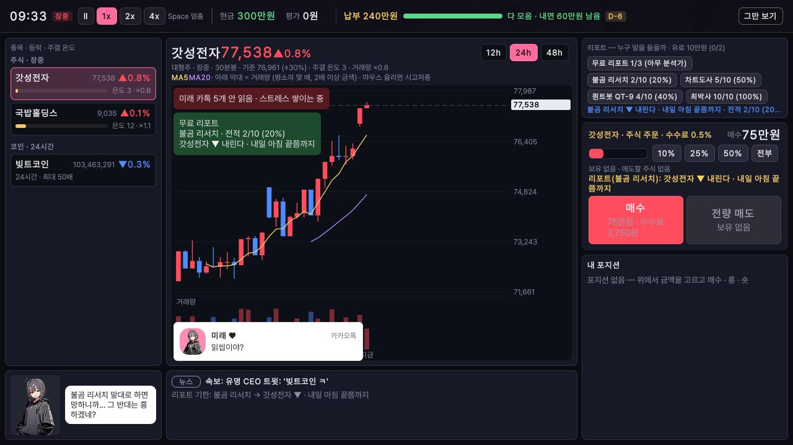

*리포트 칸에 "불곰 리서치 ▼ 내린다 · 내일 아침 끝쯤까지 · 전적 2/10"처럼 누가 · 방향 · 기한 · 전적이 뜬다.*

- 분석가는 넷: 불곰 리서치 · 차트도사 · 퀀트봇 QT-9 · 최박사.
- **무료 리포트**: 하루 3건, 분석가는 무작위. 전날 밤 푹 잤으면 +1.
- **유료 리포트**: 10만 원, 하루 2건, 분석가를 골라서 묻는다(두 번 누르기).
- **전적**(예: 2/10 (20%))이 핵심이다. 판이 시작될 때 지난 기록 10건이 깔려 있고, 발표가 날 때마다 늘어난다.
  - 분석가마다 실력이 다르고, **누가 잘 맞히는지는 판마다 바뀐다.**
  - 리포트가 빗나가면 시세는 말한 것과 **반대로** 간다. 그래서 전적이 아주 나쁜 분석가는 거꾸로 읽는 것도 방법이다.
  - 미래가 전적을 보고 한마디 한다("이 사람은 좀 믿음이 가" / "거꾸로 타면 되는 거 아냐?" / "애매한 사람 말은 애매하게 듣자").
- 결과는 **기한 안의 어느 순간**에 발표된다. 정확한 시각은 안 보인다. 발표 때 데스크 가운데 위에 "적중" 또는 "빗나감" 배너가 뜬다.
- 알바를 잘 해내면 손님이 분석가의 지난 결과를 흘려 주기도 한다(전적에 더해진다).

### 속보와 오보

- 칸이 시작할 때 **속보**가 뜰 때가 있다. 호재면 오르고 악재면 내린다.
- **30%는 가짜다.** 처음 움직임만으로는 진짜와 가짜를 가릴 수 없다. 가짜는 나중에 반대로 돌아가고, 진짜는 그 방향으로 이어진다.
- 칸 중간에 "후속: 관계자 '사실 맞다'" 또는 "후속: '사실무근' — 오보였다"가 붙기도 한다. 후속도 늘 맞지는 않는다.
- 호감 60 이상이면 하루 한 번 미래가 그날 첫 종목 속보가 "쎄한지" 말해 준다(대체로 맞는다).

---

## 5. 작전주 (2주차부터)

주식 하나에 세력이 붙어 **모아 사기 → 끌어올리기 → 설거지(한꺼번에 던지기)** 를 하는 종목이다. 1주차에는 없고, 2 · 3주차에 하나, 4주차에 둘이 생긴다. 어느 종목인지는 알려 주지 않는다.

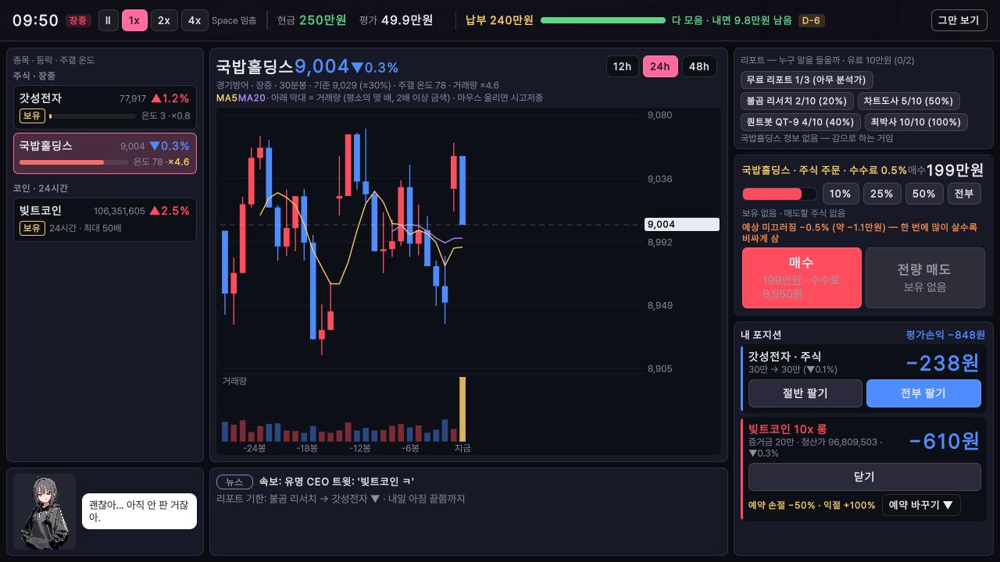

*왼쪽 목록 국밥홀딩스 줄: 온도 78 · 거래량 ×4.6. 주문 패널에 "예상 미끄러짐"이 노란 글씨로 뜬다.*

### 어떻게 읽나

1. **거래량을 본다.** 평소 거래량 배수는 1 언저리다. 주가는 그대로인데 거래량만 2~3배로 오르는 종목이 있으면 누가 모으고 있을 수 있다. 단, 거래량만 하루 반짝 오르는 가짜도 있다.
2. **주갤 온도를 본다.** 끌어올리기가 시작되면 주가가 봉마다 오르고 온도 막대가 차오르며 거래량이 크게 붙는다. 온도는 한 봉 늦게, 조금 흔들려서 보인다.
3. **온도가 높을수록 설거지가 가깝다.** 사람이 몰릴수록 팔기는 쉬워지지만 세력이 던질 때도 가까워진다. 끝까지 먹으려 하지 말 것.
4. **"큰손 매도 물량이 나온다" 줄을 놓치지 않는다.** 설거지 직전에 소식 띠에 이 줄이 뜨고 종목 줄이 깜빡이는 일이 많다. 하지만 전조 없이 던지기도 하고, 전조만 뜨고 아무 일 없기도 하다. 전조는 **장을 보고 있을 때만** 보인다.
5. **금요일 장 마감 전에는 빠진다.** 세력은 주말을 넘기지 않는다. 금요일 마지막 봉에 던지는 일이 많다.

### 설거지와 하한가 잠김

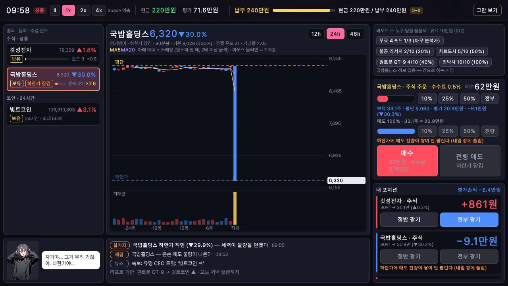

*목록에 "하한가 잠김" 꼬리표, 주문 패널과 포지션 줄에 "하한가에 매도 잔량이 쌓여 안 팔린다 (내일 장에 풀림)".*

- 설거지가 오면 그 종목은 그 자리에서 **하한가(기준가 −30%)** 로 떨어지고 **그날은 팔 수 없다.**
- 다음 장날 첫 장에 잠김이 풀리는데, 그때 한 번 더 내려서 시작한다.
- 잠긴 주식은 알바 중 몰래 폰 보기로도, 납부일 급매로도 팔리지 않는다.

### 미끄러짐

작전 종목은 **한 번에 많이 사고팔수록 값이 나빠진다**(최대 15%). 주문 패널의 "예상 미끄러짐"을 보고, 크게 들어가거나 나올 땐 **다음 봉으로 넘겨 가며** 나눠서 한다. 같은 봉(30분) 안에서 쪼개면 주문 금액이 쌓여 소용없다.

---

## 6. 매주 납부

### 구조

납부일(7 · 14 · 21 · 28일째) 밤, 김사장이 두 단계로 받아 간다.

1. **이자** = 그때 남은 빚 × 주 이자율(보통맛 3%). 은행에서 미리 냈으면 건너뛴다.
2. **원금 분납** = 지금 빚 − 그 주에 "남아도 되는 빚". 주중에 미리 갚아 두면 그만큼 줄어든다.

| 주차 | 납부일 | 납부 뒤 남아도 되는 빚 | 원금 분납 (앞 주를 딱 맞췄을 때) | 이자 (보통맛, 같은 가정) |
|---|---|---|---|---|
| 1주 | 7일째 밤 | 2,850만 | 150만 | 90만 |
| 2주 | 14일째 밤 | 2,550만 | 300만 | 85.5만 |
| 3주 | 21일째 밤 | 1,900만 | 650만 | 76.5만 |
| 4주 (만기) | 28일째 밤 | 0원 | 1,900만 | 57만 |

첫 주 납부는 띠에 "이번 주 납부 240만원"(이자 90만 + 원금 150만)으로 보인다. 빚을 미리 많이 갚을수록 다음 이자도 줄어든다.

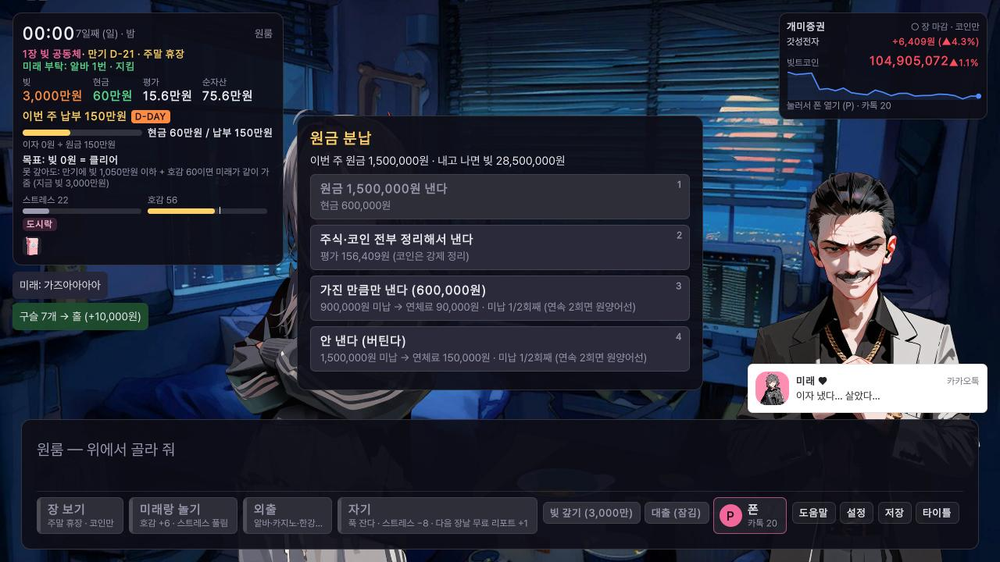

*원금 분납 창. 현금이 모자라 1번이 흐리고, 3 · 4번 아래에 미납액 · 연체료 · "미납 1/2회째"가 적혀 있다.*

### 아침 한 장 — 납부 일정

매일 아침 계획판 자리에 한 장이 뜬다. 맨 위 **납부 일정 4칸**이 이 판 전체의 숙제다.

- **이번 주 칸**: 납부액 · D-n · 모자란 돈. 모자란 돈은 현금 기준이다(상태 띠와 같다).
- **앞으로의 칸**: 매주 제때 냈을 때의 예상 납부액과, 그 주까지 낼 돈을 다 합쳐서 지금 가진 돈(현금 + 들고 있는 주식 · 코인 평가액)으로 얼마가 모자라는지("N만 더 벌어야").
- 마지막 칸까지 내면 빚이 0원이다.

첫 주 납부는 시작 현금으로 낼 수 있다. 그렇다고 할 일이 끝난 게 아니다 — 뒤 칸의 "더 벌어야"가 진짜 숙제다. 알바만으로는 마지막 칸을 못 채운다.

그 아래로 **어제** 번 돈(큰 것 3줄), **오늘** 달라진 것(미래 부탁 · 사건 · 새로 열린 것, 주 첫날엔 이번 주 한도와 아직 잠긴 것)이 이어진다.

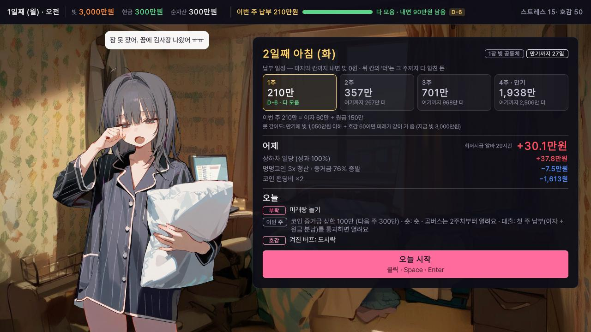

*아침 한 장. 이번 주 칸은 다 모았고, 다음 칸부터 "더 벌어야"가 적혀 있다.*

### 못 내면

**이자 단계**에서 현금이 모자라면:
- 주식 · 코인 전부 정리해서 낸다 — 코인은 강제 정리, **주식은 급매라 평가액의 20%를 손해 본다.** 하한가에 잠긴 주식은 못 판다.
- 모자란 이자를 빚에 얹는다 — 빚 한도 안에서만.
- 김사장이랑 홀짝 내기 — 한 번만. 이기면 이번 주 이자 면제, 지면 이자 2배.
- 이 모든 게 막히면 그 자리에서 끝난다.

**원금 단계**에서 모자라면:
- 주식 · 코인 전부 정리해서 낸다 (급매 손해는 같다).
- 복학 통장을 깬다 (8절, 통장이 있고 보유분을 다 정리한 뒤에만).
- 가진 만큼만 낸다 · 안 낸다 — 둘 다 **미납**이다.
  - 못 낸 원금의 **10%가 연체료로 빚에 붙는다.** 스트레스도 오른다.
  - **연속 2회 미납이면** 만기 전에 원양어선으로 끝난다. 한 번 통과하면 미납 횟수는 0으로 돌아간다.
  - 만기 주(28일째)에 못 내면 그대로 만기 결산으로 간다.

### 통과하면

- **유물 하나**를 고른다(9절).
- **첫 통과**로 김사장 대출이 열린다.
- 증거금 상한과 숏은 통과와 상관없이 **주차가 바뀌면** 오르고 열린다.

### 대출

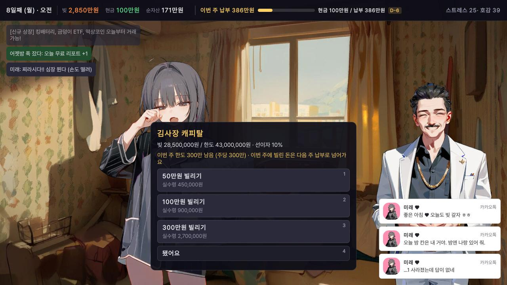

*"빚 28,500,000원 / 한도 43,000,000원 · 선이자 10%"와 이번 주 남은 한도. 실수령액이 각 단추 아래에 있다.*

| 조건 | 값 |
|---|---|
| 열리는 때 | 첫 주 납부를 통과한 뒤 |
| 빌리는 단위 | 50만 · 100만 · 300만 |
| 선이자 | 10% (300만을 빌리면 270만을 받고 빚은 300만 늘어남) |
| 이번 주 한도 | 300만 |
| 빚 한도 | 2주차 4,300만 · 3주차부터 5,000만 |
| 갚는 때 | **이번 주에 빌린 돈은 다음 주 납부로 넘어간다.** 만기 주엔 다 갚아야 한다 |

대출은 납부를 한 주 미뤄 주는 비싼 다리다. 빌린 만큼 빚과 이자가 같이 는다.

**빚이 5,000만 원을 넘으면 그 자리에서 끝난다.** 대출 한도와는 별개다. 연체료나 이야기 장면의 선택으로도 빚이 늘 수 있으니, 빚이 4,000만대라면 조심한다.

---

## 7. 미래

### 호감 (시작 50)

| 오르는 일 | 내리는 일 |
|---|---|
| 미래랑 놀기 (밤 ×1.5 · 평일 낮 ×0.5 · 주말 ×1) | 하루 종일 한 번도 안 놀아 주기 |
| 아침 부탁 지키기 | 아침 부탁 어기기 |
| 멘헤라 · 돌발 풀매수에 진심인 답 | 같은 상황에 엉뚱한 답 |
| | 복학 통장 깨기 |

호감은 높을수록 덜 오른다. 100까지 공짜로 찍을 수는 없다.

**호감 버프** (상태 카드에 켜진 것이 보인다)

| 호감 | 버프 |
|---|---|
| 40 | 도시락 — 아침마다 스트레스 −5 |
| 60 | 미래의 감 — 하루 한 번, 그날 첫 종목 속보가 쎄한지 말해 줌 (대체로 맞음) |
| 80 | 응원 — 알바 일당 +10% |

엔딩에서는 **호감 60**이 갈림길이다(10절).

### 스트레스

- 알바(특히 상하차), 큰 손실 · 청산, 부탁 어기기, 납부 미납, 안 읽은 카톡이 쌓이면 오른다.
- **이번 주 이자를 아직 안 냈으면** 납부일이 가까울수록 아침마다 스트레스가 붙는다. 은행(오전 · 오후에만 열림)에서 이자를 미리 내면 사라진다.
- **70 이상이 되면** 미래가 무너진다. 카톡 탄막이 쏟아지는 **멘헤라** 장면, 또는 미래가 아무 종목이나 현금의 90%로 사 버리려는 **돌발 풀매수**가 끼어든다. 셋 중 진심인 답을 고르면 막고 스트레스가 크게 풀린다.
- 낮추는 법: 미래랑 놀기(−12) · 쉬기(−8) · 한강공원 · 부탁 지키기 · 카톡에 좋은 답 · 호감 40 도시락.

### 아침 부탁

아침마다 미래가 카톡으로 부탁 하나를 한다. 계획판의 미래랑 놀기 카드 아래, 상태 카드에도 "부탁: …"으로 보인다.

| 부탁 | 지키려면 |
|---|---|
| 코인 금지 | 코인을 열지 않는다. **자정에 코인을 들고 있어도 어긴 것** |
| 도박 금지 | 카지노 · 복권소에 가지 않는다 |
| 알바 1번 | 알바를 한 번 간다 |
| 미래랑 놀기 | 한 번 놀아 준다 |
| 밤엔 나랑 | 밤 칸에 놀아 준다 |

자정에 판정한다. 지키면 호감 ↑ · 스트레스 ↓, 어기면 호감 −10 · 스트레스 +10.

### 카톡 답장

- 미래가 카톡으로 물어보면 폰 카톡 방에서 셋 중 하나를 고른다. **2칸 안에 답하지 않으면 읽씹**이 되어 스트레스가 오른다.
- 진심인 답은 스트레스를 낮추고, 아니면 올린다.
- 안 읽은 미래 카톡이 3개 이상 쌓이면 장을 보는 동안 스트레스가 계속 오른다(데스크 차트 위에 "미래 카톡 N개 안 읽음 · 스트레스 쌓이는 중").

### 욕심

화면에 나오지 않는 숨은 수치가 하나 더 있다. 얼마나 쌓였는지는 **아침 카톡 말투**로 드러난다. 아침에 미래가 하는 말을 흘려듣지 말 것.

---

## 8. 복학 통장

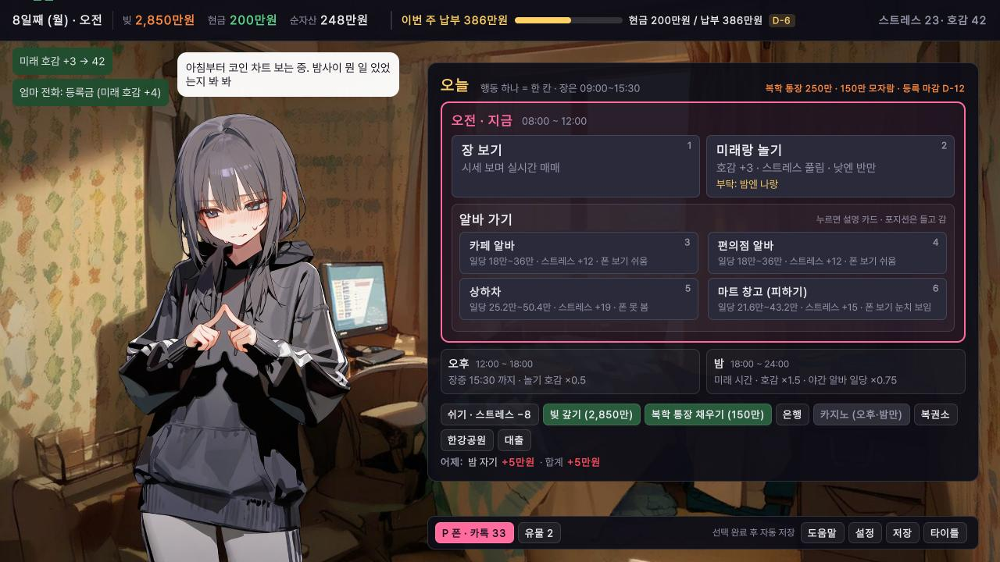

*계획판 오른쪽 위가 통장 줄이다(그림은 150만 모자란 상태라 경고색). 평소엔 "복학 통장 400만 · 등록 마감 D-n". 모자라면 아래 칩 줄에 "복학 통장 채우기"가 생긴다.*

- **4일째 무렵** 미래의 복학 통장 **400만 원**이 생긴다. 그때부터 계획판 · 상태 카드에 통장 줄이 보인다.
- 통장 돈은 현금이 아니다. 매매에도 이자에도 쓰이지 않는다.
- 단, 미래가 통장 돈으로 "딱 한 번만" 해 보자고 할 때가 있다. **같이 타면 통장이 그 칸 동안 판돈이 되어, 칸이 끝날 때 시세만큼 불거나 줄어든다.** 말리면 통장은 그대로다.

### 납부 때 깨기

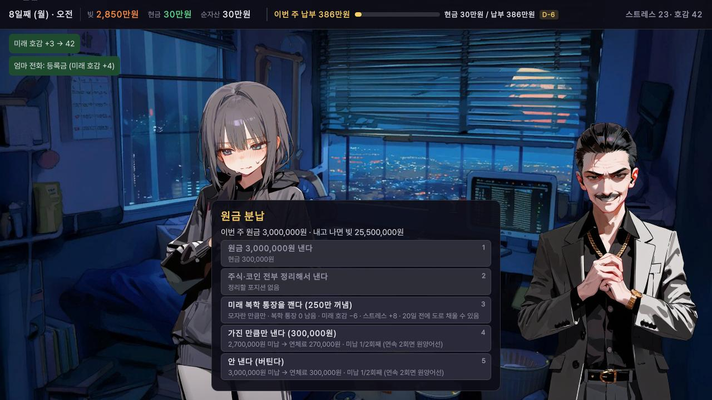

*원금 분납 창의 "미래 복학 통장을 깬다 (N 꺼냄)" 선택지. 아래 줄에 남는 잔액과 비용이 적혀 있다.*

- **원금 분납 단계에서만** 깰 수 있다. 통장은 마지막 수단이다: **팔 수 있는 주식 · 코인이 남아 있으면 선택지가 잠겨 있고**("먼저 주식·코인을 정리해야 깰 수 있음"), 다 정리하고도 현금이 모자랄 때 열린다. 하한가에 잠겨 못 파는 주식은 남아 있어도 된다.
- 꺼내는 돈은 **현금으로 모자란 만큼을 100만 원 단위로 올린 금액**(잔액이 그보다 적으면 잔액 전부).
- 깰 때마다 **호감 −6 · 스트레스 +8**.
- 깨고 나면 선택지가 다시 떠서, 이제 낼 수 있으면 원금을 낸다.

### 도로 채우기

- 집 계획판 칩 줄에 **"복학 통장 채우기 (금액)"** 이 생긴다. 두 번 눌러야 한다. 칸은 쓰지 않는다.
- 현금에서 10만 원 단위로 채운다. **20일째까지만** 채울 수 있다.

### 20일째 등록 마감

- 20일째가 등록 마감이다. 그날 등록을 정하는 장면이 나온다. 통장이 모자라면 현금이 충분할 때 그 자리에서 채워 등록할 수도 있다.
- 20일째가 지나도록 등록하지 않으면 **미등록**이 된다. 상태 줄이 "등록 마감 지남"으로 바뀐다.
- 20일째까지 빚을 다 갚으면, 통장 + 현금으로 400만이 되는 한 저절로 등록된다.
- 등록하면 통장 돈은 학교로 간다. 그 뒤로는 납부 때 통장을 깰 수 없다.

### 등록 여부로 달라지는 것

| 결과 | 등록함 | 등록 못 함 |
|---|---|---|
| 빚 0원 + 호감 60 이상 | 진엔딩 | 미래는 있는데, 미래가 없다 |
| 만기에 꽤 갚음 + 호감 60 이상 | 혼자 원양어선, 미래는 졸업 | 둘이 같이 원양어선 |

---

## 9. 유물

아빠가 집안 물건을 모아 둔 "유물 상자"에서 꺼내는 물건. 게임 끝까지 효과가 유지된다.

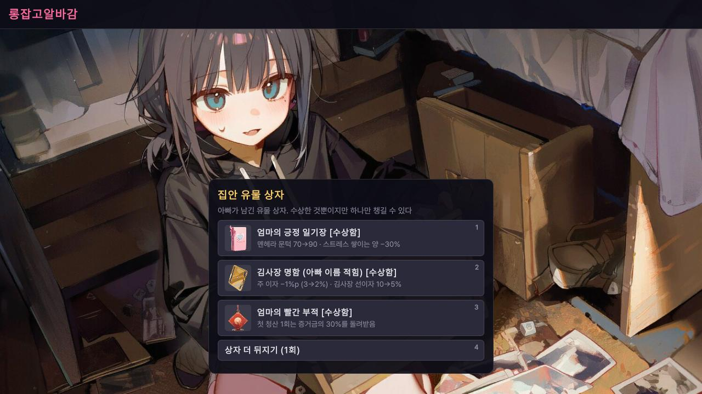

*셋 중 하나를 고른다(숫자 키 1~3). 4번 "상자 더 뒤지기 (1회)"로 한 번 다시 뽑을 수 있다.*

- **언제 얻나**: 게임 시작 때 하나, **1 · 2 · 3주차 납부를 통과할 때마다** 하나 (한 판에 많아야 4개).
- **등급**: 수상함 < 골동품 < 가보.

유물은 모두 17종이다. 아래는 그중 일부.

| 유물 | 등급 | 효과 |
|---|---|---|
| 엄마의 긍정 일기장 | 수상함 | 멘헤라 문턱 70→90 · 스트레스 쌓이는 양 −30% |
| 김사장 명함 (아빠 이름 적힘) | 수상함 | 주 이자 −1%p (3→2%) · 김사장 선이자 10→5% |
| 엄마의 빨간 부적 | 수상함 | 첫 청산 1회는 증거금의 30%를 돌려받음 |
| 아빠의 목장갑 | 수상함 | 알바 일당 +15% |
| 할머니 김장 김치통 | 수상함 | 하루 첫 코인 롱은 증거금의 5% (최대 30만 원) 얹어 줌 |
| 할아버지의 돌하르방 | 골동품 | 3일(9칸) 넘게 들고 있던 주식을 팔 때 수익 +30% |
| 아빠의 낡은 VIP 카드 | 골동품 | 주식 수수료 반값 · 무료 리포트 하루 +1건 |
| 할아버지 산삼주 | 골동품 | 알바 스트레스 −30% |
| 아빠의 올인 주사위 | 가보 | 현금 95% 이상 넣은 코인 포지션 손익 ×1.5 (청산도 그만큼 빨라짐) |

유물 아이콘은 계획판 아래 "유물" 단추와 상태 카드에서 다시 볼 수 있다.

---

## 10. 엔딩과 도전과제

### 엔딩 도감

타이틀 화면 "기록"에서 본 엔딩과 힌트를 확인할 수 있다. 도감에 적힌 그대로:

| 엔딩 | 힌트 |
|---|---|
| 진엔딩 | 빚도 갚고, 미래도 곁에, 복학 등록까지 |
| 미래는 있는데, 미래가 없다 | 빚도 갚고 미래도 곁에 있는데, 복학 등록을 못 했다면 |
| 돈은 갚았는데 | 빚은 0원. 근데 옆자리가 비었다 |
| 갚고도 FLEX | 갚는 순간에도 통장이 넉넉하다면 |
| 도박으로 갚음 | 알바보다 매매보다 도박이 더 벌어 줬다면 |
| 혼자 원양어선, 미래는 졸업 | 만기까지 꽤 갚았고, 등록금만은 지켰다면 |
| 둘이 같이 원양어선 | 만기까지 꽤 갚았고, 미래가 따라온다 (학교엔 못 돌아갔다) |
| 혼자 원양어선 | 갚을 만큼 못 갚았거나, 혼자였거나 |
| 갤 운영자에게 팔려 감 | 갤에서 너무 유명해진 채 이자를 못 내면 |
| 털고 튐 | 김사장 금고에 관심을 가져 보자 |
| 금고 앞에서 | 준비가 덜 된 채 금고 앞에 서면 |
| 도박 중독 | 중독된 채 빈털터리가 되면 |
| 편의점 무한루프 | 알바는 많이 했는데 올인으로 끝나면 |
| 미래 폭주 | 포지션 든 채로 미래 멘탈이 터지면 |
| 미래 가출 | 미래 카톡을 계속 나쁘게 받아치면 |

"꽤 갚았다"의 기준은 상태 카드의 "못 갚아도" 줄에 나온다. 보통맛은 만기에 빚 1,050만 이하 + 호감 60.

빚을 다 갚고 엔딩을 보면 **2부**로 이어서 할 수 있다.

### 도전과제

| 도전과제 | 힌트 |
|---|---|
| 첫 엔딩 | 아무 엔딩이나 한 번 보기 |
| 진엔딩 | 빚도 갚고, 미래도 곁에, 복학 등록까지 |
| 돈은 갚았는데 혼자 | 빚 0원. 근데 옆자리가 비었다 |
| 같이 원양어선 | 다 못 갚아도 같이 가 줄 사람이 있다면 |
| 무대출 클리어 | 추가 대출 한 푼 없이 빚 다 갚기 |
| 정직한 알바생 | 매매 한 번 안 하고 클리어하거나 같이 원양어선 |
| 50배의 사나이 | 50배 포지션을 열고도 클리어 |
| 청산 마니아 | 청산을 다섯 번 당하고 엔딩 보기 |
| 2주 컷 | 14일 안에 클리어 |
| 미래 바라기 | 미래 호감 100으로 엔딩 보기 |
| 약속은 지킨다 | 부탁을 10번 넘게 지키고 한 번도 안 어기기 |
| 매운맛 클리어 | 매운맛 난이도로 클리어 |
| 2부 진엔딩 | 아빠의 차용증까지 깨끗하게 |
| 1억 찍어 봄 | 최대 자산 1억 원 달성 |
| 졸업 | 복학 통장을 한 번도 안 깨고 졸업식 보기 |

이 밖에 숨은 도전과제가 몇 개 있다.

---

## 11. 처음 하는 사람에게 권하는 첫 주

1. **1일째 아침**: 띠의 "이번 주 납부"(보통맛 240만)를 확인한다. 시작 현금 300만이면 이미 "다 모음"이다. 이 금액만큼은 7일째 밤까지 날리지 않을 돈으로 생각한다. 모자라게 되면 그만큼은 알바로 채운다.
2. **매일**: 아침 부탁을 확인하고, 하루 한 번은 미래랑 놀아 준다. 같은 놀기라도 평일엔 **밤 칸**이 낮의 세 배 효율이다. 밤엔 "자기"로 마무리하면 다음 장날 무료 리포트가 하나 는다.
3. **1주차 장 보기**: 무료 리포트 3건을 받아 분석가 전적을 쌓는다. 1주차엔 증거금 상한이 100만이라 크게 잃기도 어렵다. 이 주는 누가 잘 맞히는지 배우는 주다.
4. **알바 가기 전**: 배율 높은 코인 포지션은 정리하거나, 장 보기 칸에서 예약 손절을 걸어 둔다. 상하차는 폰을 못 보니 포지션을 비우고 가는 게 편하다.
5. **4일째 무렵**: 복학 통장이 생긴다. 20일째 마감까지 통장을 400만으로 유지하는 게 진엔딩 조건이다.
6. **5일째(금) 오후 장 마감 전**: 주식을 들고 주말을 넘길지 정한다. 주말 움직임은 월요일 오전에 한꺼번에 온다.
7. **7일째 밤**: 이자 + 원금을 내고 유물을 고른다. 첫 통과 뒤로 대출이 열리지만, 빌린 돈은 다음 주 납부에 그대로 얹힌다.

---

## 12. 조작 · 단축키 · 저장 · 난이도

### 키

| 키 | 하는 일 |
|---|---|
| 클릭 · Space · Enter | 대사 넘기기 |
| 숫자 1~9 | 선택지 고르기. 집에서는 계획판 지금 칸 카드 순서 (카드 오른쪽 위 숫자) |
| P | 폰 열기/닫기 |
| Esc | 상태 카드 · 폰 · 설정 닫기 |
| 1 · 2 · 4 | 장 보기 중 속도 |
| Space | 장 보기 중 멈춤 / 다시 흐르기 |

미니게임 키는 시작 전에 그림 안내 카드로 나온다. 예: 카페 = 숫자 1~5 담기 · 0 비우기 · Enter/Space 서빙, 편의점 = Space/Enter 스캔, 상하차 = Space/Enter 연타, 마트 창고 = ← → 또는 A D.

### 저장

- **자동 저장**: 선택(행동)이 끝날 때마다 · 장 보는 동안 30초마다 · 타이틀로 갈 때 · 게임을 끄거나 내릴 때.
- **알바 미니게임 중에는 저장되지 않는다.**
- 직접 저장: 계획판 아래 작은 줄이나 상태 카드의 "저장". 마지막 저장 시각이 "저장 완료 · 시:분"으로 뜬다.
- 이어서 할 때는 타이틀의 "이어하기".

### 난이도

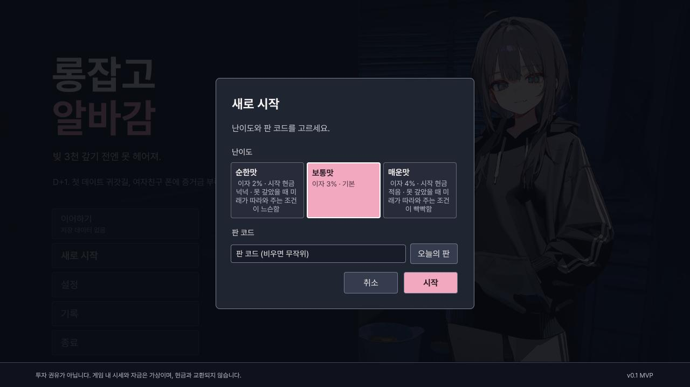

*타이틀 "새로 시작"에서 난이도와 판 코드를 고른다. 판 코드를 비우면 무작위.*

| | 순한맛 | 보통맛 | 매운맛 |
|---|---|---|---|
| 주 이자 | 2% | 3% | 4% |
| 시작 현금 | 450만 | 300만 | 180만 |
| 알바 일당 | ×1.15 | ×1 | ×0.85 |
| 같이 원양어선 기준 (만기 빚) | 1,350만 이하 | 1,050만 이하 | 750만 이하 |
| 하루 안 놀면 호감 | −2 | −4 | −5 |
| 돌발 풀매수 확률 | ×0.5 | ×1 | ×1.3 |

납부 일정(남아도 되는 빚 2,850만 · 2,550만 · 1,900만 · 0원)과 증거금 상한은 난이도와 상관없이 같다. 그래서 첫 주 납부는 순한맛 210만 · 보통맛 240만 · 매운맛 270만이다.

---

## 13. 자주 묻는 것

**Q. 주식이 왜 안 팔려요?**
셋 중 하나다. ① 주식 주문은 **장 보기 칸에서만** 된다(집 폰 증권 앱은 코인용). ② 장이 닫혀 있다 — 평일 09:00~15:30 밖, 또는 주말. ③ 작전 종목이 설거지를 당해 **하한가에 잠겼다** — 다음 장날 첫 장에 풀린다.

**Q. 알바 중에 청산당했어요.**
알바 중에도 시세는 흐른다. 알바 화면 구석의 손익을 보다가 몰래 폰 보기로 정리하거나(일당 −15%, 들킬 수 있음), 가기 전에 장 보기 칸에서 예약 손절을 걸어 둔다. 배율을 낮추면 청산가가 멀어진다.

**Q. 대출이 잠겨 있어요.**
첫 주(7일째 밤) 납부를 통과해야 열린다. 단, 납부일 이자 단계에서 모자란 이자를 빚에 얹는 건 그 전에도 된다.

**Q. 통장을 깼는데 다시 채울 수 있나요?**
된다. 20일째까지 계획판 칩 줄의 "복학 통장 채우기"로 현금에서 10만 원 단위로 채운다. 칸은 쓰지 않는다.

**Q. 숏 버튼이 잠겨 있어요.**
숏은 2주차부터 저절로 열린다.

**Q. 증거금 상한 때문에 주문이 안 들어가요.**
코인 증거금 합계가 그 주 상한(100만 · 300만 · 500만 · 800만)을 넘으면 안 들어간다. 다른 포지션을 닫거나 다음 주를 기다린다.

**Q. 리포트대로 했는데 반대로 갔어요.**
그 분석가가 빗나간 것이다. 빗나간 리포트는 시세가 반대로 간다. 전적이 나쁜 분석가의 말은 거르거나 거꾸로 읽는다.

**Q. 납부를 한 번 못 냈어요. 끝인가요?**
아니다. 못 낸 원금에 10% 연체료가 붙고 미납 1회가 된다. 다음 주에 통과하면 0으로 돌아간다. **두 번 연속**이면 끝난다.
