# 화면 전체 (167af10)

> 배포본을 화면 없는 브라우저(1280×720)로 열어 캡처 모드(`?kwShots=1`)로 찍은 것. 캡처 모드는 저장을 쓰지 않고 늘 같은 새 판으로 돈다.
> ※ 표시는 실제 게임 흐름으로 가기 어려워 같은 화면 코드에 값만 넣어 띄운 화면. 화면 구성 설명과 공통 규칙은 `UIUX.md`.
> 다시 만들기: `KW_PLAYWRIGHT=<playwright 경로> node tools/screens/capture.js "<배포 주소>/?kwShots=1" 8765 <폴더>` → `/status` 가 done 이면 `python3 tools/screens/make_doc.py <폴더> <커밋>`.

모두 82장.

- [타이틀](#타이틀) — 4장
- [오프닝과 첫날](#오프닝과-첫날) — 10장
- [장 보기와 폰](#장-보기와-폰) — 13장
- [알림](#알림) — 3장
- [외출과 알바](#외출과-알바) — 13장
- [저녁과 밤](#저녁과-밤) — 7장
- [돈: 대출 · 상환 · 놀거리](#돈-대출-상환-놀거리) — 8장
- [납부 관문 (7일째 밤)](#납부-관문-7일째-밤) — 6장
- [엔딩](#엔딩) — 16장
- [미래 표정](#미래-표정) — 2장

## 타이틀

### 타이틀

이어하기 · 새로 시작 · 설정 · 기록 · 종료.

### 새로 시작

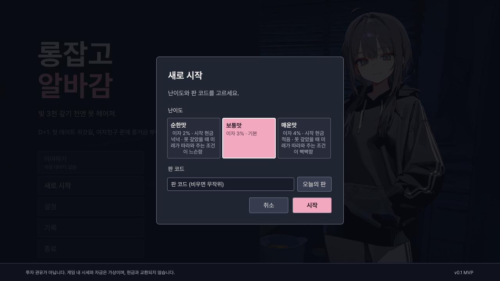

난이도(순한맛 · 보통맛 · 매운맛)와 판 코드. 난이도 설명은 풀어 쓴 문장.

### 설정 (타이틀)

음량 · 전체 화면.

### 기록

판 수 · 클리어 · 엔딩 도감.

## 오프닝과 첫날

### 오프닝 — 석 달 전

불장 차트 카드로 시작.

### 오프닝 — 100일 기념 고백

"나 빚 3천 있어 ㅎㅎ"

### 오프닝 — 김사장 방문

원금 3,000만 · 주 이자 · 7일마다 수금.

### 오프닝 — 유물 상자

"아빠 유물 상자. 하나쯤은 쓸모 있겠지?"

### 유물 고르기

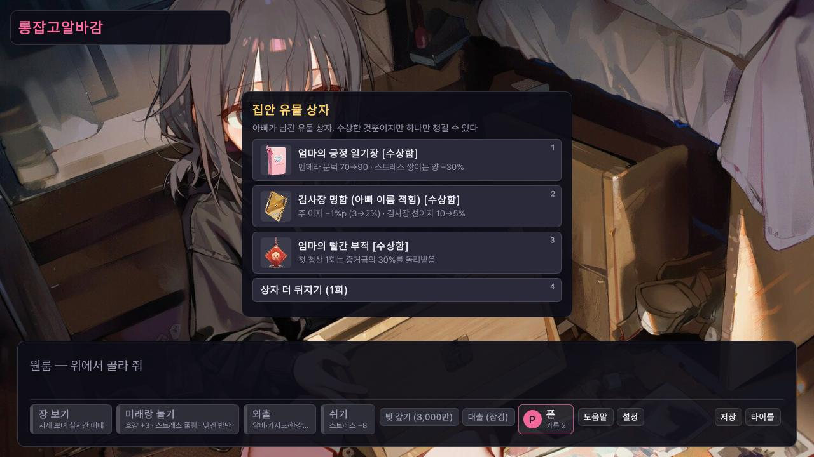

시작 유물 셋 중 하나. 선택지 오른쪽 위 번호 = 숫자 키.

### 아침 카드 (첫날)

장 이름 · 이번 주 납부 · 목표. ※ 첫날은 게임이 아침 카드를 안 띄워서 같은 화면 코드에 값을 넣어 띄운 것.

### 집 (낮)

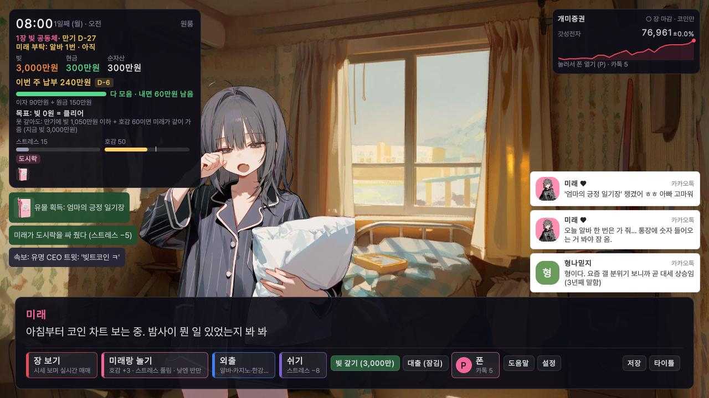

왼쪽 위 HUD: 빚 · 현금 · 순자산 → 이번 주 납부(막대) → 목표: 빚 0원. 아래 퀵메뉴.

### 도움말 카드

짚는 곳만 밝히고 설명. 퀵메뉴 '도움말'로 다시 볼 수 있음.

### 유물 설명 카드

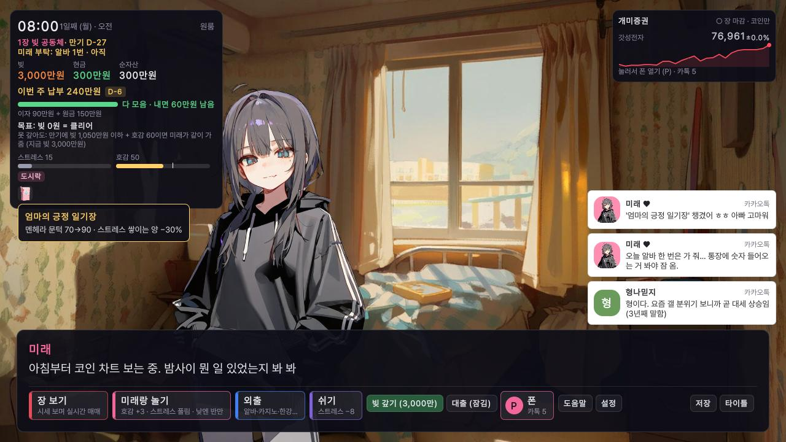

HUD 의 유물 아이콘을 누르면 이름과 효과.

### 설정 (게임 안)

음량 · 글자 속도 · 화면 효과 · 읽은 대사 빨리 넘기기.

## 장 보기와 폰

### 장 보기

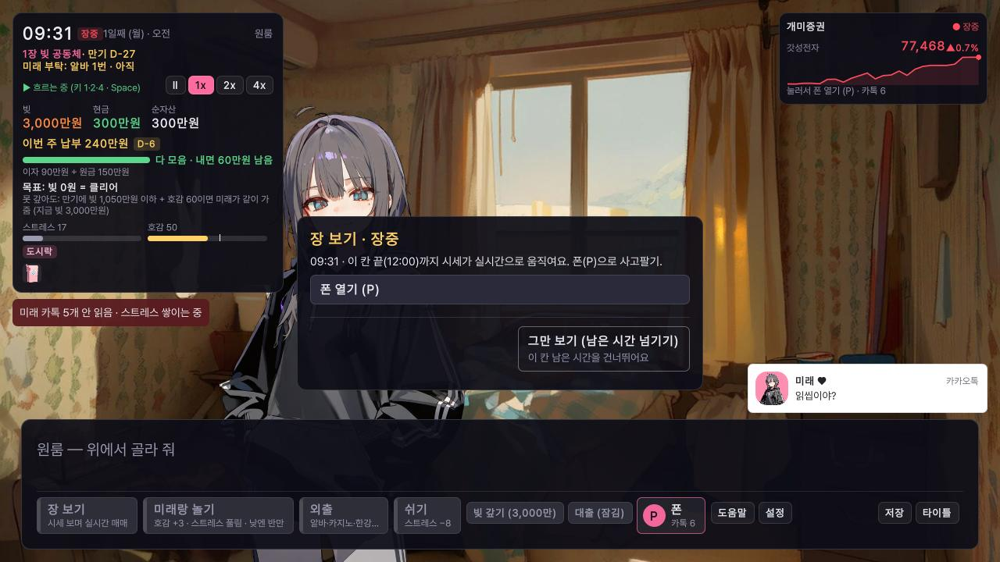

속도 Ⅱ/1x/2x/4x (키 1·2·4, Space = 멈춤). '그만 보기'는 따로 떨어져 있고 포지션이 있으면 한 번 더 눌러야 함.

### 폰 — 시세

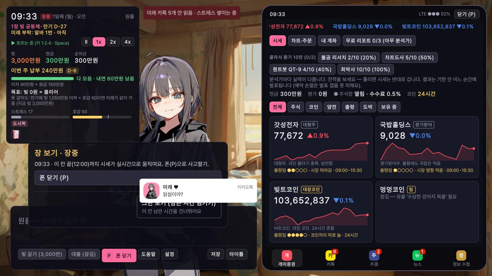

분석가 칩(이름 + 전적) · 종목 카드. 폰이 열리면 선택지 상자는 HUD 아래로.

### 폰 — 리포트를 받은 뒤

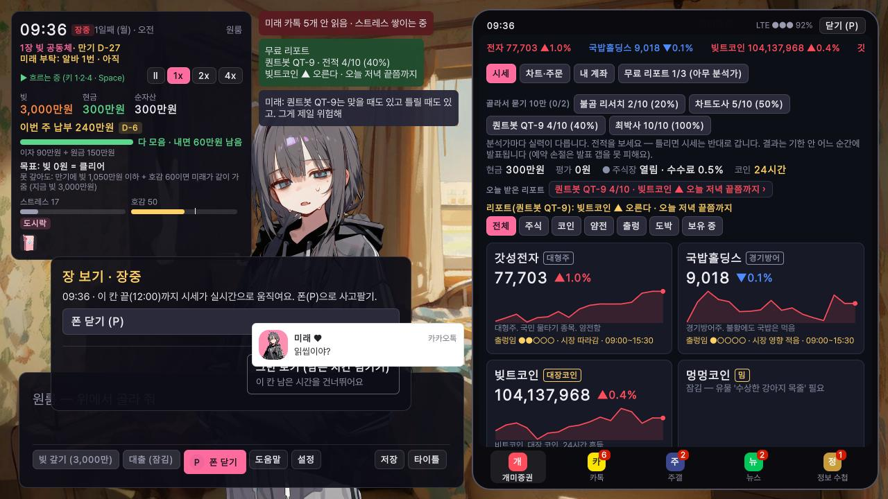

오늘 받은 리포트 칩에 누가 썼는지와 전적. 누르면 그 종목 주문으로.

### 차트 · 주문 (코인)

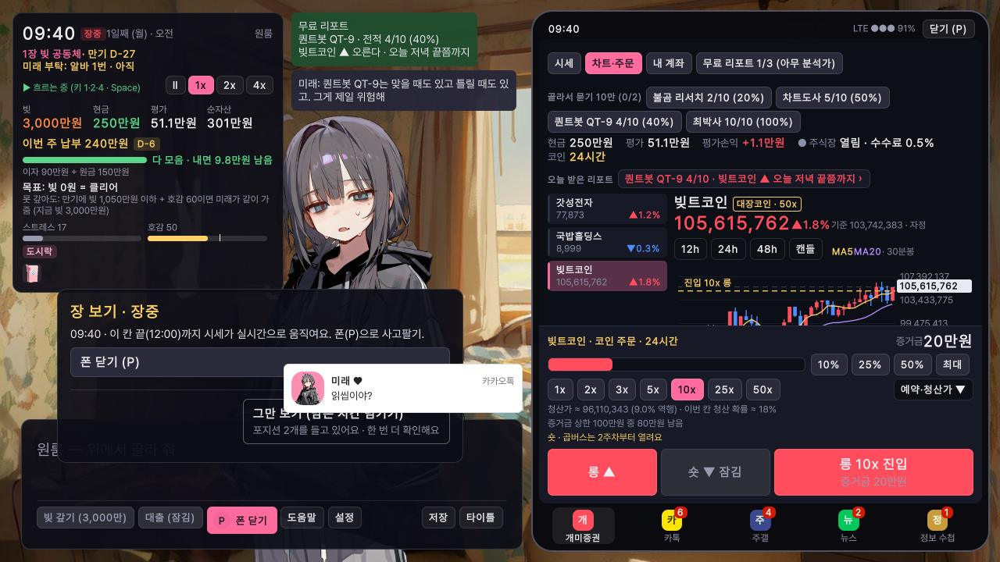

아래 고정 주문 바: 금액 · 배율 · 한 줄 요약(청산가 · 청산 확률) · 증거금 상한 남은 돈 · 롱/숏/진입.

### 차트 · 주문 — 예약 · 청산가 펼침

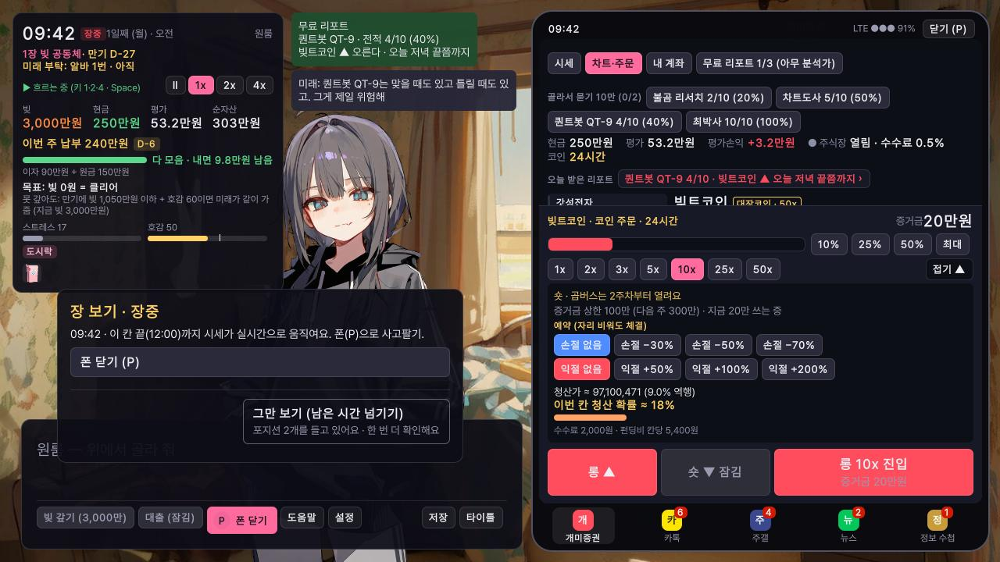

예약 손절 · 익절 칩, 청산 확률 막대, 수수료.

### 차트 · 주문 (주식)

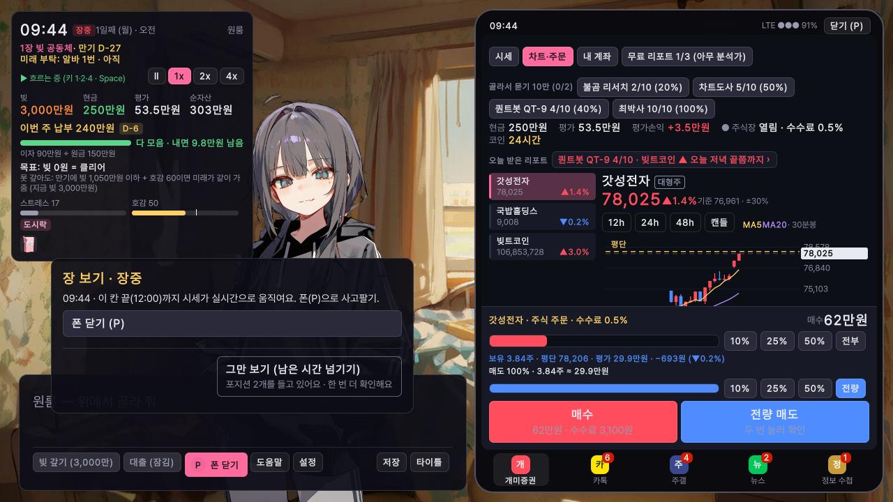

매수 금액 / 매도 비율 막대.

### 위험한 주문 — 한 번 더

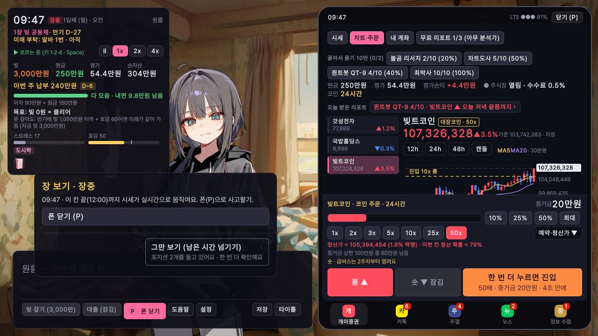

25배 이상 · 증거금 100만 이상 · 청산 확률 30% 이상이면 버튼이 '한 번 더 누르면 진입'으로 바뀜.

### 내 계좌

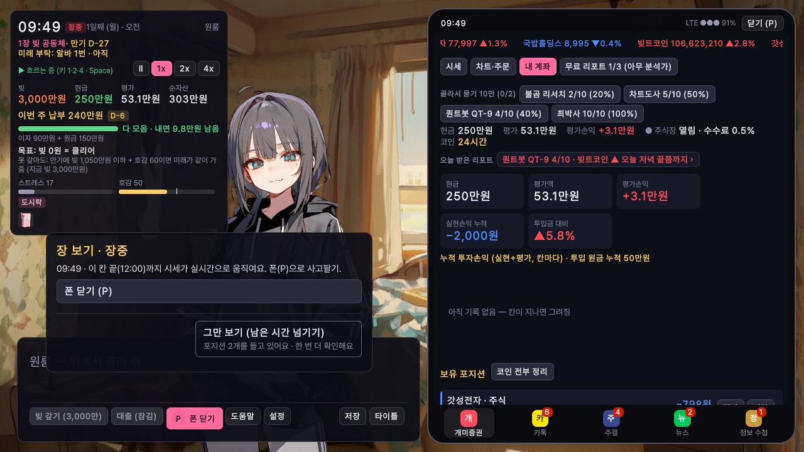

보유 주식 · 코인 포지션. 포지션 줄에서 예약을 걸고 바꿈.

### 카톡

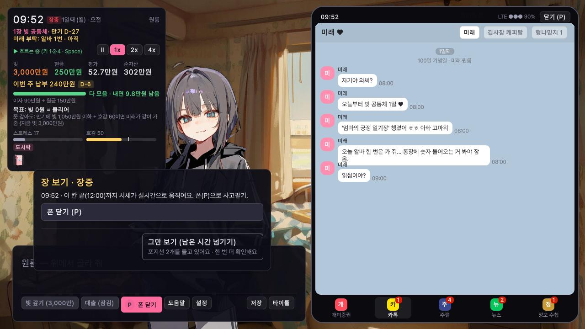

미래 · 김사장 · 형나믿지.

### 주갤 — 목록

### 주갤 — 글

### 뉴스

칸이 시작할 때 속보.

### 정보 수첩

진행 중인 정보와 출처별 전적.

## 알림

### 발표 배너

리포트 결과가 뜨는 순간 위쪽 가운데 띠: 종목 · 방향 · 분석가 적중/빗나감 · 보유 중. ※ 값을 넣어 띄운 것.

### 예약 체결 배너

예약 손절 · 익절이 체결되면. ※ 값을 넣어 띄운 것.

### 현금 ± 숫자

현금이 바뀌면 HUD 현금 옆에 잠깐 떠오름.

## 외출과 알바

### 동네 지도

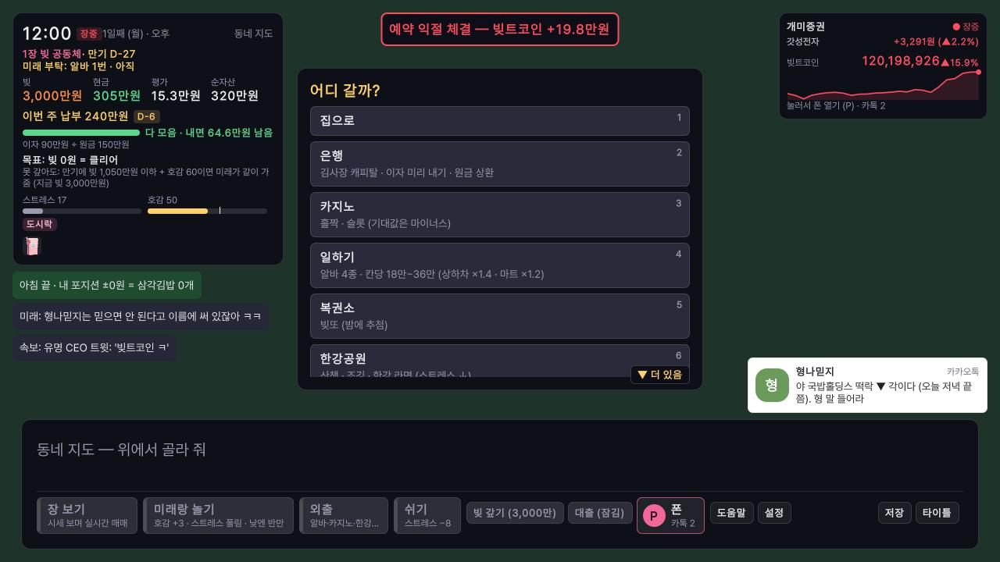

넘치면 스크롤 + '▼ 더 있음'.

### 말 거는 사람

길에서 만나는 정보원.

### 일하기

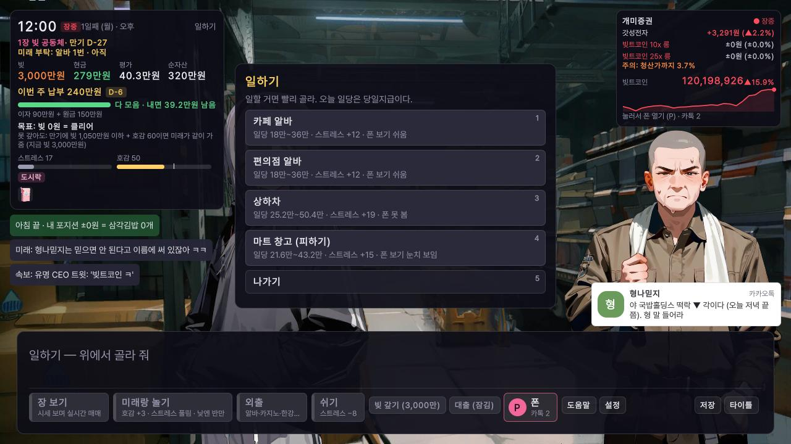

알바 4종: 일당 · 스트레스 · 폰 보기 쉬움/눈치/못 봄.

### 알바 설명 카드

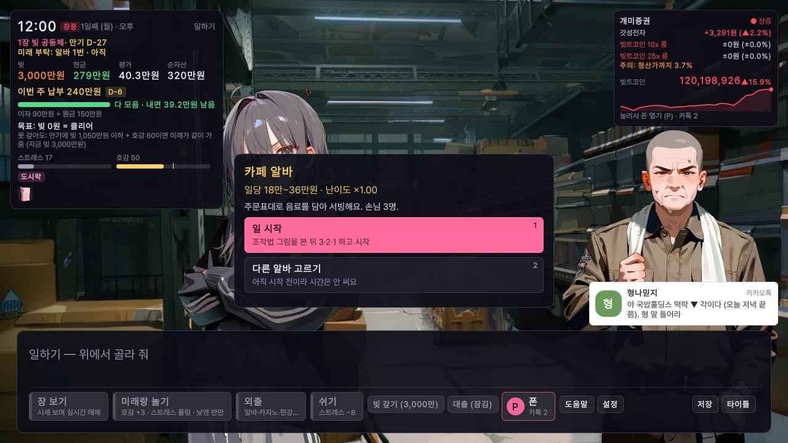

일당 · 난이도 · 한 줄 요약 · '다른 알바 고르기'(시간 안 씀).

### 카페 알바

주문표대로 담아 서빙.

### 편의점 알바

초록 구간에 삑.

### 상하차

연타로 박스 올리기. 폰을 못 봄.

### 마트 창고

떨어지는 박스 피하기.

### 포지션을 든 채 알바

오른쪽 아래 구석에 내 포지션 손익 + '몰래 폰 보기'.

### 몰래 폰 보기 창

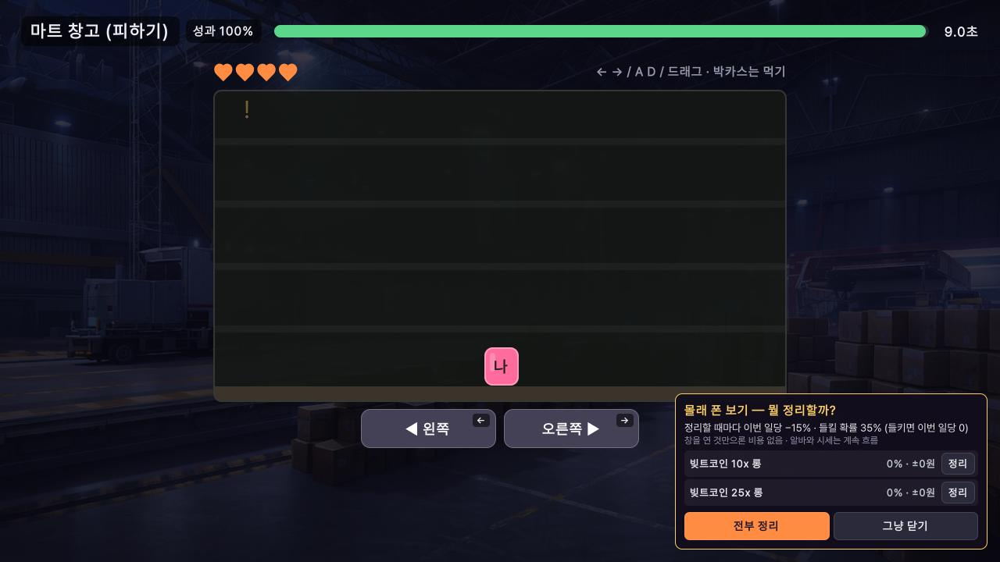

포지션마다 [정리] · [전부 정리] · [그냥 닫기]. 여는 것만으론 비용 없음, 게임과 시세는 계속 흐름.

### 알바 중 청산

청산 연출 + 구석에 붉은 줄. ※ 연출만 띄운 것.

### 그림 안내 카드

미니게임 시작 전 조작법.

### 알바 결과 카드

등급 · 성과 · 예상 일당.

## 저녁과 밤

### 저녁 정산 카드

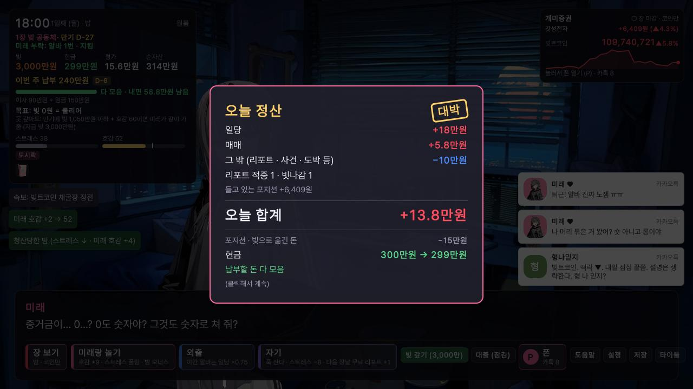

일당 · 매매 · 그 밖 · 오늘 합계 · 옮긴 돈 · 현금 A → B · 납부까지. ※ 모든 줄이 보이게 값을 넣어 띄운 것.

### 집 (밤)

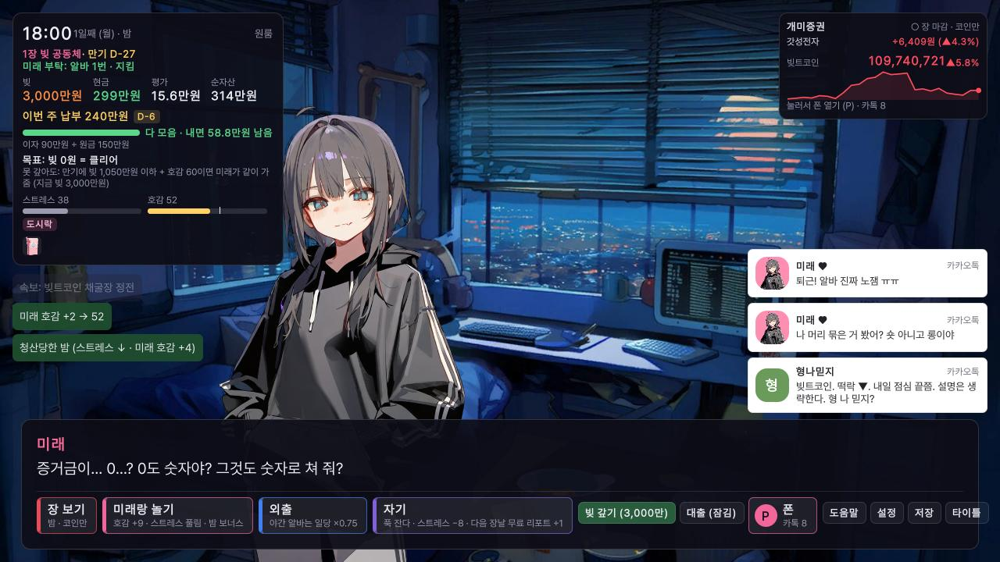

### 돌발 이벤트

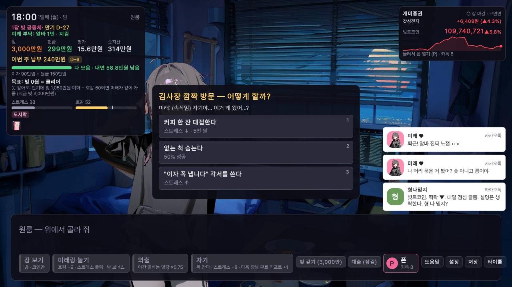

카드 제목이 이벤트 제목, 선택지에 번호.

### 멘헤라

스트레스가 꽉 차면 카톡 탄막.

### 돌발 풀매수 알림

미래가 몰래 사 버림. ※ 값을 넣어 띄운 것.

### 도박 유혹

중독도가 높을 때. ※ 선택 상태를 직접 놓은 것.

### 청산당한 밤

그날 청산당했으면 밤에 뜨는 장면. ※ 선택 상태를 직접 놓은 것.

## 돈: 대출 · 상환 · 놀거리

### 김사장 대출 (잠김)

첫 납부를 통과해야 열림.

### 김사장 대출 (열림)

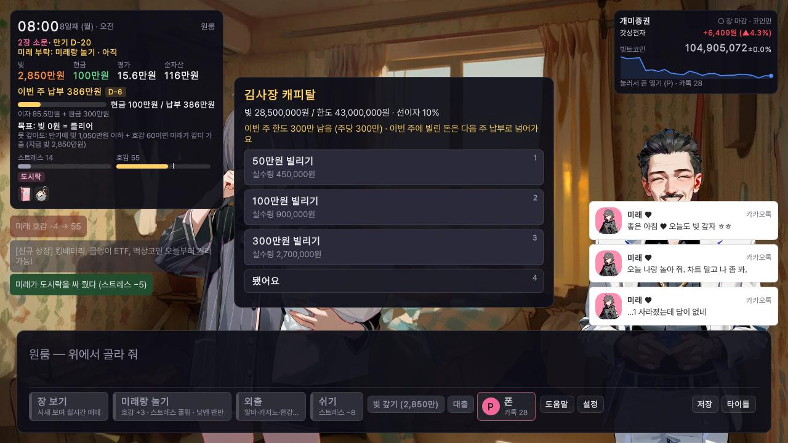

이번 주 한도 · 빌린 돈은 다음 주 납부로.

### 은행

이자 미리 내기 · 원금 상환.

### 빚 갚기

### 카지노

### 카지노 — 한 판

### 복권소

### 한강공원

## 납부 관문 (7일째 밤)

### 이자일

김사장이 옴. 이자 내기.

### 원금 분납 — 모자람

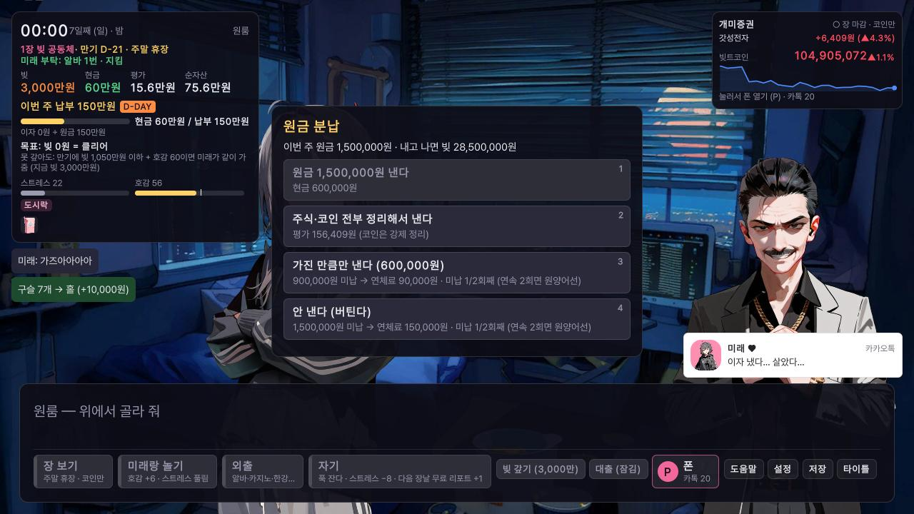

가진 만큼만 내기 · 급매 · 미납.

### 원금 분납 — 낼 수 있음

### 통과 보상 유물

납부를 통과하면 유물 하나.

### 장 카드 (2장 시작)

주가 바뀌면 그 주의 판 분위기.

### 미납 경고

한 번 더 미납하면 원양어선. ※ 값을 넣어 띄운 것.

## 엔딩

### 진엔딩

빚 0 + 호감 60↑.

### 엔딩 점수판

### 2부 시작

축하 치킨 뒤 김사장의 차용증.

### 돈은 갚았는데

빚 0 + 호감 60 미만.

### 갚고도 FLEX

### 도박으로 갚음

### 혼자 원양어선

### 둘이 같이 원양어선

### 갤 운영자에게 팔려 감

### 털고 튐

### 금고 앞에서

### 도박 중독

### 편의점 무한루프

### 과로

체력이 없어진 지금 규칙에선 도달할 수 없음(도감 정리 대상).

### 미래 가출

### 미래 폭주 (전량 매도)

## 미래 표정

### 스탠딩 1

base · excited · smug · shy · pout · annoyed · tired · pajama.

### 스탠딩 2

crying · crying_comic · shocked · dizzy · mental · yami · flex · love.
